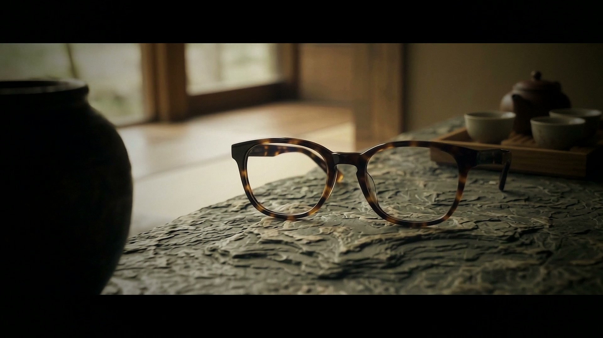
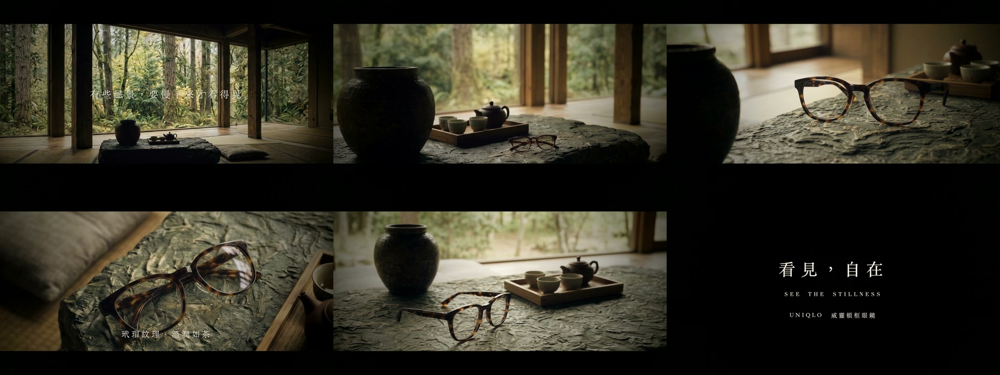

# 《靜觀 See the Stillness》AI 眼鏡概念廣告

[](https://youtu.be/E_XXhJQ-reg)

一支 29 秒的 UNIQLO 威靈頓框眼鏡概念廣告。畫面全部由 **Google Flow** 生成，剪輯、調色、轉場、字卡與原創配樂則用 **Claude Code + FFmpeg** 以程式完成。

▶ **觀看影片**：https://youtu.be/E_XXhJQ-reg

> 本作品為課堂作業的概念廣告，並非 UNIQLO 官方廣告。畫面中的眼鏡為 AI 生成，可能與實際商品不同。

## 創作理念：慢下來，才看得清

把眼鏡塑造成「讓人重新看見生活細節的物件」。場景設定在森林中的日式茶室，以石桌、陶器、茶具呼應玳瑁鏡框的溫潤質感。



| 時間 | 段落 | 內容 |
|---|---|---|
| 0–12 秒 | 入靜 | 森林茶室全景、緩慢推軌，第一次瞥見眼鏡。字卡「有些風景，要慢下來才看得見」 |
| 12–24 秒 | 相遇 | 白光轉場＋低音重擊，主角眼鏡登場、玳瑁紋理特寫、焦點轉移。字卡「玳瑁紋理．溫潤如茶」 |
| 24–29 秒 | 收尾 | 拉遠回到森林，片尾字卡「看見，自在 / SEE THE STILLNESS」 |

## 製作流程

1. **影像生成**：Google Flow 生成 5 段 1080p 影片，提示詞見 [docs/企劃與提示詞.md](docs/企劃與提示詞.md)
2. **選鏡**：用場景偵測把影片拆成 15 個鏡頭，挑出 11 個；刪掉 AI 生成時眼鏡變形或重複的鏡頭
3. **剪輯與特效**（[tools/build.py](tools/build.py)、[tools/finalize.py](tools/finalize.py)）
   - 每個鏡頭加上緩慢推近或拉遠的鏡頭運動
   - 暖色電影調色（eq、colorbalance、curves）
   - 溶接、白光、黑場轉場（xfade）
   - 2.39:1 寬銀幕黑邊、暗角、底片顆粒
4. **原創配樂**（[tools/music.py](tools/music.py)）：用 Python 從零合成鋼琴琶音、弦樂鋪底、漸強與重擊音，和弦時間依剪輯點自動對齊，沒有使用任何有版權的音樂
5. **字卡**（[tools/text.swift](tools/text.swift)）：用 macOS CoreText 輸出透明 PNG 字卡（宋體、Didot）

## 重新產生影片

需要 macOS、Python 3、FFmpeg（`brew install ffmpeg`）：

```bash
./run.sh /path/to/原始素材
```

成品會輸出到 `build/stillness_ad.mp4`。原始的 Google Flow 影片沒有放進這個專案。
